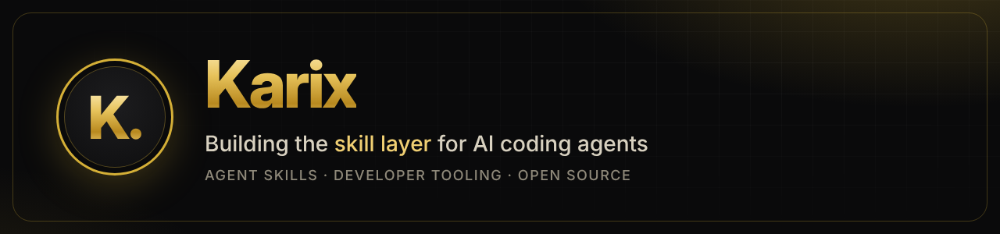

Most great projects die quietly with 10 stars. Not because the code is bad, but because nobody ever sees it.

I build skills for AI coding agents that fix the part nobody teaches: the README that sells in 15 seconds, the demo, the Hacker News post at the right hour, the first comment that wins the thread. You install them once, and your agent just knows.

### ✨ launch-skills

**[launch-skills](https://github.com/karix-ai/launch-skills)** turns Claude Code, Cursor or Codex into your launch team. Ten skills, built on data from 188,000 Hacker News posts.

```bash
npx skills add karix-ai/launch-skills
```

Then just ask: *"audit my repo for launch"*.

### ✨ Things I believe

- A good README is a landing page, not a manual
- The best launch is one loud day, not a quiet month
- Agents are only as good as the skills you give them
- Ship small, fix fast, say thank you in public

Launched something with these skills? **[Tell me your numbers](https://github.com/karix-ai/launch-skills/issues/new?template=launch-report.md).** I read every one.
